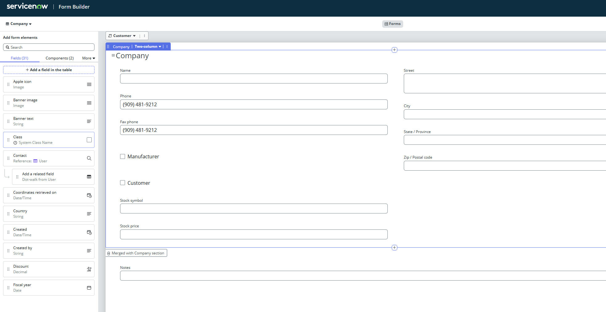
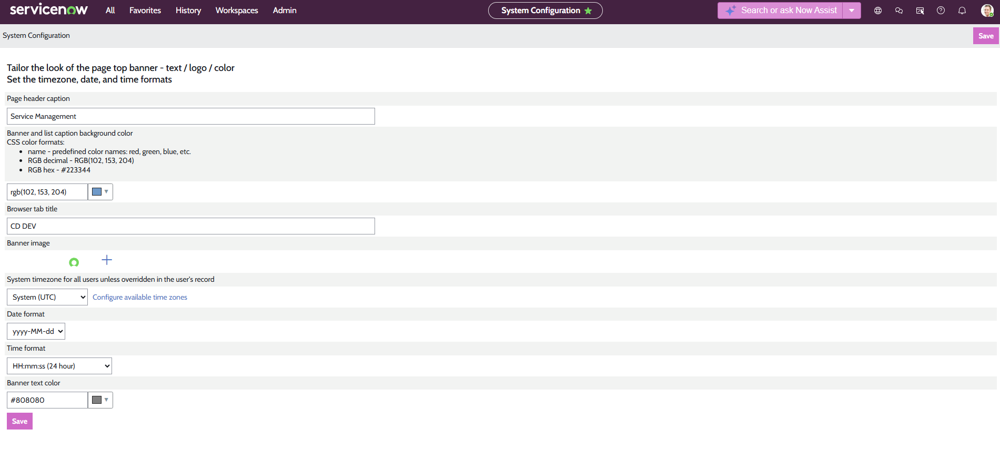

# Module 2 — Platform Theme & Instance Configuration

**Platform:** ServiceNow (Now Experience Framework)
**Environment:** Personal Development Instance (DEV)
**Part of:** [ServiceNow Administration Labs](../README.md) — CSA Certification Preparation

> Independently configured a ServiceNow development instance to reflect organizational branding and operational best practices. Work performed included creation of a custom platform theme, modification of organizational records via Form Builder, and system property administration for environment identification — all completed and verified in a personal development instance.

---

## Tasks Completed

### Task 1 — Custom Platform Theme

**Navigation:** `All > Now Experience Framework > Theme Management > Theme Builder`

Created and published a custom theme named **Cloud Dimensions**:

- Primary colour: `#0B4653`
- Neutral colour: `#CCCCCC`
- Typography: Lato
- Uploaded company logo asset
- Published as instance default, then unpublished after verification

---

### Task 2 — Company Record & Form Builder

**Navigation:** `All > User Administration > Companies`

- Updated company name from *ACME Americas* → **Cloud Dimensions**
- Opened **Form Builder** on the record
- Added the **Manufacturer** field to the form layout
- Cleared the Manufacturer checkbox

**Evidence:**

*The Company form in Form Builder, showing the Manufacturer field successfully added to the layout alongside standard fields (Name, Phone, Fax phone, Customer, Stock symbol, Stock price).*

---

### Task 3 — System Properties: Environment Identification

**Navigation:** `All > System Properties > Basic Configuration`

- Set Browser Tab Title to: **CD DEV**
- Verified label renders in browser tab and Contextual App Pill
- Added System Properties page to Favorites
- `instance_name` property left unchanged per best practice

**Evidence:**

*The Basic Configuration system properties page showing the Browser Tab Title field set to "CD DEV", confirming the development instance is correctly identified and distinguishable from test and production environments.*

---

## Skills Demonstrated

| Area | Specifics |
|---|---|
| Now Experience Framework | Theme Builder, brand asset upload, publish lifecycle |
| User Administration | Company records, organizational data governance |
| Form Builder | Field addition, form layout customisation |
| System Properties | Environment identification, browser configuration |
| Platform Navigation | Favorites, Contextual App Pill, multi-module navigation |

---

## Documentation

Full write-up with objectives, configurations, and verified outcomes:
[Module_2_ServiceNow_Platform_Theme.docx](./Module_2_ServiceNow_Platform_Theme.docx)

---

[← Back to main repo](../README.md)
