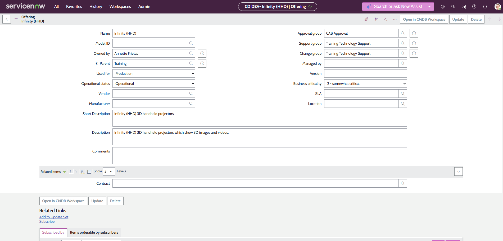

# Module 3 — Customize Lists, Forms, and Field Values

**Platform:** ServiceNow (Now Platform)
**Environment:** Personal Development Instance (DEV)
**Part of:** [ServiceNow Administration Labs](../README.md) — CSA Certification Preparation

> Independently extended the ServiceNow Incident table with a custom field, configured a tailored list view using the List Collector tool and dot-walking, and established a dedicated application menu and module for role-based navigation — all performed and verified in a personal development instance as part of self-directed CSA certification preparation.

---

## Labs Completed

### Lab 3.1.1 — Create a Custom Field on the Incident Table

**Navigation:** `All > System Definition > Tables`

**Scenario:** As IT Product Owner preparing for a new internal product launch, a custom field was required to flag and filter incidents associated with the pilot rollout program.

**Configuration applied:**

- Located the **Incident** table in System Definition
- Added a new field named **Pilot**
- Field type: **True/False** (checkbox)
- Default value: `false`

**Outcome:** The Pilot field is available on the Incident table and defaults to unchecked for all new incident records, enabling the team to flag pilot-related incidents without modifying core platform functionality.

**Evidence:**

<!-- Add screenshot: screenshots/pilot-field-incident-table.png -->
> *Screenshot coming soon — add to `screenshots/` folder*

---

### Lab 3.1.2 — Create a Custom List View (HHD)

**Navigation:** `All > Incident > All`

**Scenario:** The product management team required a dedicated incident list view surfacing only pilot-relevant fields, including configuration item details accessible via dot-walking, to reduce noise from standard incident columns.

**Configuration applied:**

- Right-clicked a column header → **Configure > List Layout**
- Created a new list view named: **HHD**
- Configured the following fields in display order:

| # | Field | Source |
|---|-------|--------|
| 1 | Number | Incident table |
| 2 | Pilot | Incident table (custom) |
| 3 | Category | Incident table |
| 4 | Opened | Incident table |
| 5 | Configuration item | Incident table |
| 6 | Configuration item.Model ID | Dot-walked from CI |
| 7 | Configuration item.Install Status | Dot-walked from CI |
| 8 | Short description | Incident table |
| 9 | Caller | Incident table |
| 10 | State | Incident table |

- Removed: Priority, Assignment group

**Key technique — dot-walking:** Fields prefixed `Configuration item.` were accessed by traversing the reference field relationship from the Incident table to the Configuration Item (CI) table. Related fields appear in green with a `+` indicator in the List Collector.

**Outcome:** The HHD list view renders only the relevant fields for tracking pilot incidents, including CI model and install status, enabling faster triage without manual filtering.

**Evidence:**

<!-- Add screenshot: screenshots/hhd-list-view.png -->
> *Screenshot coming soon — add to `screenshots/` folder*

---

### Lab 3.1.3 — Configure Application Menu and Module

**Navigation:** `All > System Definition > Application Menus`

**Scenario:** To eliminate the need for team members to manually navigate and filter standard incident menus, a dedicated navigation entry was created for the Holographic Handheld Devices (HHD) product launch team.

**Application Menu created:**

| Field | Value |
|-------|-------|
| Title | HHD |
| Roles | itil |
| Category | Custom Applications |
| Hint | Holographic Handheld Devices |

**Module created within HHD menu:**

| Field | Value |
|-------|-------|
| Title | Incidents and Inquiries |
| Order | 10 |
| Hint | HHD Incidents and Inquiries |
| Roles | itil |
| Link type | List of Records |
| Table | Incident \[incident\] |
| View name | HHD |
| Filter | Service offering **contains** HHD |

**Outcome:** The HHD application menu appears in the Application Navigator alongside standard menus. Users with the `itil` role can access the Incidents and Inquiries module which automatically loads the HHD list view pre-filtered to pilot incidents — eliminating manual navigation steps.

**Evidence:**

<!-- Add screenshot: screenshots/hhd-app-menu-navigator.png -->
<!-- Add screenshot: screenshots/hhd-module-config.png -->
> *Screenshots coming soon — add to `screenshots/` folder*

---

### Lab 3.2.1 — Add a Field to a Form (Form Builder)

**Navigation:** `All > Incident > Open`

**Scenario:** As Service Desk Manager, the Pilot checkbox needed to be visible on the Incident form so agents can flag pilot-related incidents at the point of data entry, improving HHD tracking quality.

**Configuration applied:**

- Opened an existing incident record in the **Default** view
- Accessed **Form Builder** from the form header menu
- Located the existing **Pilot** (True/False) field in the field palette
- Dragged and positioned Pilot **below the Configuration item field** in the Default view layout
- Saved and verified the field renders correctly on the form

**Outcome:** The Pilot checkbox is now visible and editable directly on the Incident form (Default view), allowing agents to flag pilot incidents without navigating away or using list editing.

**Evidence:**

> *Screenshot: field visible on incident form in Default view*

---

### Lab 3.3.1 — Add a Firmware Subcategory (Choice List)

**Navigation:** `All > Incident > Create New`

**Scenario:** Hardware incidents involving firmware could not be properly subcategorised, creating a gap in incident reporting. A "Firmware" subcategory was added as a dependent value under the Hardware category.

**Configuration applied:**

- Created a new incident record and set **Category** to `Hardware`
- Right-clicked the **Subcategory** field label → **Configure Choices**
- Added a new choice: **Firmware**
- Repositioned Firmware to appear **before Keyboard** in the sorted list
- Verified the subcategory appears and is dependent on Hardware category selection

**Outcome:** Agents selecting Hardware as the incident category now see Firmware as a valid subcategory option, enabling accurate classification and filtering of firmware-related incidents.

---

### Lab 3.3.2 — Create a Business Service and Service Offering

**Navigation:** `All > CSDM > Sell and Consume > Business Service`

**Scenario:** The organisation acquired Infinity HHD 3D handheld projectors for training. A new service structure was needed to properly route and categorise incidents related to this equipment.

**Business Service created — Training:**

| Field | Value |
|-------|-------|
| Name | Training |
| Owned by | Annette Frietas |
| Used for | Production |
| Operational status | Operational |
| Service classification | Business Service |
| Approval group | CAB Approval |

**Service Offering created — Infinity (HHD):**

| Field | Value |
|-------|-------|
| Name | Infinity (HHD) |
| Owned by | Annette Frietas |
| Parent | Training |
| Used for | Production |
| Operational Status | Operational |
| Approval group | CAB Approval |
| Business criticality | 2 – somewhat critical |
| Short Description | Infinity (HHD) 3D handheld projectors. |
| Description | Infinity (HHD) 3D handheld projectors which show 3D images and videos. |

**Outcome:** Both the Training business service and the Infinity (HHD) service offering are available in ServiceNow, enabling accurate categorisation and routing of incidents to the appropriate support team.

**Evidence:**

---

### Lab 3.3.3 — Create a Support Group and Enable Auto-Assignment

**Navigation:** `All > User Administration > Groups`

**Scenario:** The new Training service and Infinity (HHD) offering required a dedicated support group so incidents are automatically routed to the correct personnel.

**Configuration applied:**

- Created a new group: **Training Technology Support**
- Added four members:
  - Beth Anglin
  - Bow Ruggeri
  - David Loo
  - Annette Frietas
- Assigned the **itil** role to the group
- Configured the **Training** business service:
  - Support group → Training Technology Support
  - Change group → Training Technology Support
- Configured the **Infinity (HHD)** service offering:
  - Support group → Training Technology Support
  - Change group → Training Technology Support

**Outcome:** Incidents and changes related to the Training service and Infinity (HHD) offering are automatically routed to the Training Technology Support group, eliminating manual assignment and ensuring the right team receives the work.

**Evidence:**

---

## Skills Demonstrated

| Area | Specifics |
|---|---|
| Table Administration | Custom field creation (True/False), default values |
| List Customisation | List Collector, view creation, column ordering |
| Dot-walking | Cross-table field access via reference fields |
| Application Navigator | Custom application menus, module configuration |
| Access Control | Role-based visibility (`itil` role assignment) |
| List Filtering | Condition builder, service offering filter |
| Form Builder | Field placement, Default view layout customisation |
| Choice Lists | Dependent values, subcategory ordering |
| CSDM | Business Service and Service Offering creation |
| Group Management | Group creation, member assignment, role assignment |
| Auto-assignment | Support group and Change group configuration on services |

---

[← Back to main repo](../README.md)
