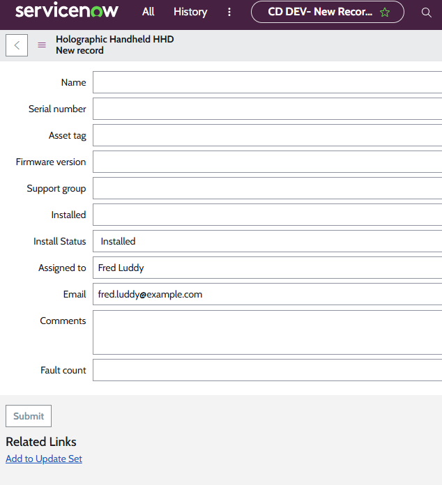
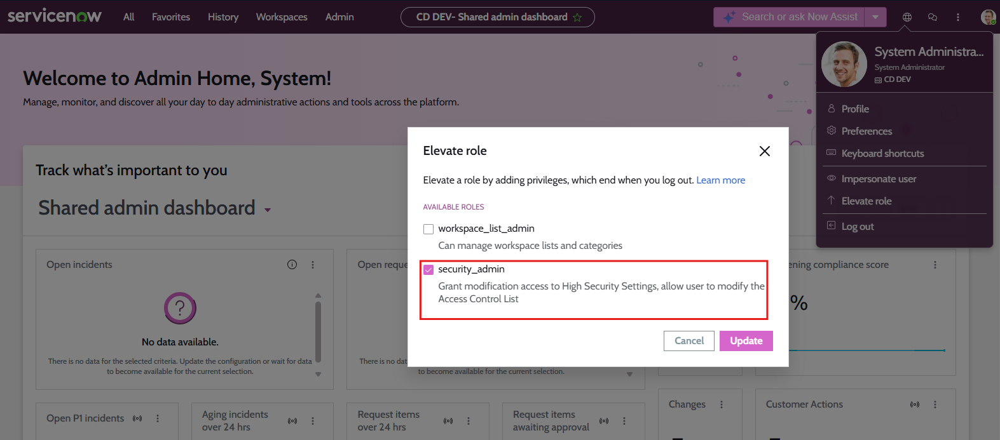

# Module 4 — Build and Secure Table Data

**Platform:** ServiceNow (Now Platform)
**Environment:** Personal Development Instance (DEV)
**Part of:** [ServiceNow Administration Labs](../README.md) — CSA Certification Preparation

> Designed and secured a custom CMDB table (Holographic Handheld Devices) end-to-end — extending the Hardware table, configuring form layouts with dot-walking, building application menus, implementing role-based access controls, and applying both record-level and field-level ACLs — all verified through user impersonation in a personal development instance.

---

## Labs Completed

### Lab 4.1.1 — Create a Table, Field, and List Layout

**Navigation:** `All > System Definition > Tables`

**Scenario:** The IT department acquired a fleet of Holographic Handheld Devices (HHDs). The asset management team needed a dedicated CMDB table to track firmware versions and expose the right columns to the Service Desk.

**Configuration applied:**

- Created a custom table in the **Global** scope:
  - **Table label:** Holographic Handheld HHD
  - **Table name:** `u_cmdb_ci_hardware_hhd`
  - **Extends:** Hardware `[cmdb_ci_hardware]`
- Added a custom field directly from the list layout:

| Field | Value |
|-------|-------|
| Type | String |
| Column label | Firmware version |
| Column name | `u_firmware_version` |
| Max length | 40 |

- Configured the list layout with 9 columns in this order:

| # | Column |
|---|--------|
| 1 | Name |
| 2 | Serial Number |
| 3 | Asset tag |
| 4 | Firmware version |
| 5 | Support group |
| 6 | Installed |
| 7 | Install Status |
| 8 | Assigned to |
| 9 | Comments |

**Outcome:** A CMDB-compliant HHD table is available under the `u_` naming convention, inheriting all Hardware fields plus the new firmware tracking field, with a list view optimised for Service Desk triage.

---

### Lab 4.1.2 — Arrange Form Elements

**Navigation:** `All > HHD > Holographic Handheld Devices`

**Scenario:** Support technicians found the default form layout difficult to use. They also needed to see the assigned technician's email directly on the form without navigating away.

**Configuration applied:**

- Accessed **Form Builder** via the form's Additional actions menu → Configure > Form Builder
- Arranged 10 fields in logical order:

| # | Field |
|---|-------|
| 1 | Name |
| 2 | Serial Number |
| 3 | Asset tag |
| 4 | Firmware version |
| 5 | Support group |
| 6 | Installed |
| 7 | Install Status |
| 8 | Assigned to |
| 9 | Comments |
| 10 | Fault count |

- Applied **dot-walking** to add `Assigned to.Email` directly beneath the Assigned to field
- Verified the dot-walked email field auto-populates when a user is selected

**Key technique — dot-walking in Form Builder:** Dot-walked fields traverse reference field relationships — selecting `Assigned to.Email` pulls the email value from the referenced User record and renders it read-only on the HHD form.

**Outcome:** The HHD form now displays fields in a logical troubleshooting order, and support staff can see the assigned technician's email without leaving the record.

**Evidence:**

---

### Lab 4.1.3 — Update an Application Menu

**Navigation:** `All > (hover over) HHD > Edit Application`

**Scenario:** The Service Desk had no quick way to open a blank HHD form. A "Create New" module was added and the existing list module was renamed for clarity.

**Configuration applied:**

- Opened the existing **HHD** application menu via the Edit Application icon
- Created a new module:

| Field | Value |
|-------|-------|
| Title | Create New |
| Application menu | HHD |
| Order | 100 |
| Link type | New Record |
| Table | Holographic Handheld HHD `[u_cmdb_ci_hardware_hhd]` |

- Renamed the existing list module for improved clarity
- Verified both changes were immediately visible in the Application Navigator

**Outcome:** The HHD application menu now contains a direct "Create New" shortcut, reducing the steps needed to log a new device record.

---

### Lab 4.2.1 — Add Access Controls

**Navigation:** `All > (hover over) HHD > Edit Application`

**Scenario:** The HHD application was initially configured with the `itil` role, granting access to all IT staff. Access needed to be restricted to only the auto-generated `u_holographic_handheld_hhd_user` role.

**Configuration applied:**

- Verified the `u_holographic_handheld_hhd_user` role was auto-created during table setup
- Replaced the `itil` role with `u_holographic_handheld_hhd_user` on the **HHD application menu**
- Updated both HHD modules — removed `itil`, added `u_holographic_handheld_hhd_user` to each

**Outcome:** The HHD application and all its modules are now hidden from general `itil` users and visible only to users holding the `u_holographic_handheld_hhd_user` role.

---

### Lab 4.2.2 — Grant Roles to Support Groups

**Navigation:** `All > User Administration > Groups`

**Scenario:** The role was configured but no users could access the HHD application yet — the role had not been assigned to any group.

**Configuration applied:**

- Located the **Service Desk** group → added the `u_holographic_handheld_hhd_user` role
- Located the **Training Technology Support** group → added the `u_holographic_handheld_hhd_user` role

**Outcome:** All members of the Service Desk and Training Technology Support groups now inherit access to the HHD application through their group role membership.

---

### Lab 4.2.3 — Test Visibility Settings

**Navigation:** User menu → Impersonate User

**Scenario:** Verification was needed that users inside the HHD support groups could see the application, while users outside could not — using impersonation to confirm without modifying any permissions.

**Test results:**

| User | Group membership | HHD access | Result |
|------|-----------------|------------|--------|
| Bernard Laboy | Not in HHD groups | No | HHD application hidden ✓ |
| Annette Frietas | Training Technology Support | Yes | All 3 modules visible; able to submit a record ✓ |

**Outcome:** Role-based access controls confirmed working correctly through impersonation — the principle of least privilege is enforced.

---

### Lab 4.2.4 — Establish Access Control Rules

**Navigation:** User menu → Elevate role → `security_admin`

**Scenario:** IT staff with `itil` could still see ALL incidents, including sensitive HHD incidents. Record-level ACLs were needed on the Incident table to restrict read, write, and create operations to the `u_holographic_handheld_hhd_user` role for HHD-related incidents.

**Configuration applied:**

Elevated privileges to `security_admin`, then created 3 ACL records on the **Incident** table:

| Operation | Role required | Data condition |
|-----------|--------------|----------------|
| read | `u_holographic_handheld_hhd_user` | Service offering **is** Infinity (HHD) |
| write | `u_holographic_handheld_hhd_user` | Service offering **is** Infinity (HHD) |
| create | `u_holographic_handheld_hhd_user` | Service offering **is** Infinity (HHD) |

All ACLs set: Admin overrides ✓, Active ✓

**Outcome:** HHD incidents (where Service Offering = Infinity (HHD)) are no longer accessible to general `itil` users — only users with the `u_holographic_handheld_hhd_user` role can read, write, or create them.

**Evidence:**

---

### Lab 4.2.5 — Create a New ACL (Field-Level)

**Navigation:** `All > User Administration > Roles`

**Scenario:** Support staff could accidentally overwrite Asset tag values, which are tied to inventory, financial reporting, and compliance. A field-level write ACL was needed to lock the Asset tag field to a specialised role only.

**Configuration applied:**

- Created a new role: `u_hhd_asset_tagger` (Application: Global)
- Navigated to the ACL list, filtered for `u_cmdb_ci_hardware_hhd` with `write` operation
- Located the `Asset tag` field on the Holographic Handheld HHD table
- Added `u_hhd_asset_tagger` as the required role for that field-level ACL
- Updated description: "Asset Tagger access control on u_cmdb_ci_hardware_hhd"

**Outcome:** The Asset tag field on HHD records is write-protected — only users with the `u_hhd_asset_tagger` role can modify it. All other fields remain editable for standard support staff.

---

### Lab 4.2.6 — Grant a Role for Tagging

**Navigation:** `All > User Administration > Groups`

**Scenario:** The `u_hhd_asset_tagger` role existed but had no users. Annette Frietas was designated as the asset manager and needed asset tag write access via a dedicated group for auditability.

**Configuration applied:**

- Created a new group: **HHD Asset Taggers**
- Assigned the `u_hhd_asset_tagger` role to the group
- Added **Annette Frietas** as a group member

**Outcome:** Annette Frietas inherits the `u_hhd_asset_tagger` role through group membership, gaining write access to the Asset tag field. Future asset taggers can be onboarded by simply adding them to the HHD Asset Taggers group.

---

### Lab 4.2.7 — Test the Asset Tag

**Navigation:** User menu → Impersonate User

**Scenario:** Final verification that the field-level ACL is working — regular support staff should see Asset tag as read-only, while the asset manager should be able to edit it.

**Test results:**

| User | Role | Asset tag field | Result |
|------|------|----------------|--------|
| Beth Anglin | `u_holographic_handheld_hhd_user` only | Read-only (greyed out) ✓ | Cannot modify asset tag |
| Annette Frietas | `u_holographic_handheld_hhd_user` + `u_hhd_asset_tagger` | Editable ✓ | Can modify asset tag |

- Ended impersonation and de-elevated `security_admin` role after testing

**Outcome:** Field-level ACL confirmed working. The Asset tag field is appropriately locked for general users and writable only for designated asset taggers.

---

## Skills Demonstrated

| Area | Specifics |
|------|-----------|
| Table Administration | Custom table creation, CMDB inheritance, `u_` naming conventions |
| Field Configuration | String field creation, max length, column naming |
| List Layout | Column selection and ordering via List Collector |
| Form Builder | Field arrangement, drag-and-drop layout configuration |
| Dot-walking | Cross-table field traversal (Assigned to → Email) on forms |
| Application Menus | Module creation, link types (New Record), order configuration |
| Role-Based Access Control | Role creation, application/module role restriction |
| Group Management | Role-to-group assignment, membership management |
| User Impersonation | Access verification without modifying live permissions |
| Record-Level ACLs | Read/write/create ACLs with data conditions on Incident table |
| Field-Level ACLs | Write ACL on a specific field (`Asset tag`) requiring specialised role |
| Security Privilege Elevation | `security_admin` role elevation for ACL administration |

---

[← Back to main repo](../README.md)
